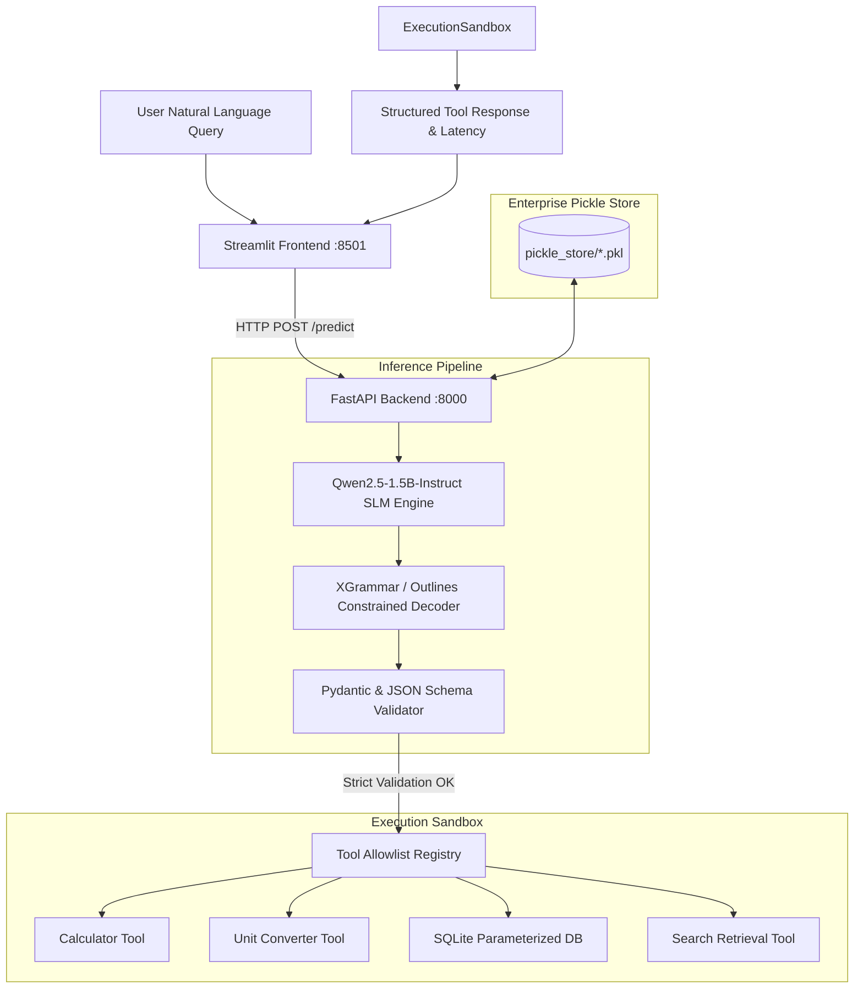

# Small Language Model for Reliable Tool Calling

A complete, production-grade Small Language Model (SLM) tool-calling engine powered by **Qwen2.5-1.5B-Instruct**, **QLoRA / LoRA**, **Constrained Grammar Decoding**, **FastAPI**, and **Streamlit**.

This system runs locally without relying on frontier closed APIs (e.g. OpenAI/Anthropic) at inference time, achieving sub-200ms latencies and fitting safely within **4GB VRAM** consumer GPUs.

---

## Architecture and Data Flow



---

## 4GB VRAM Feasibility Analysis

Deploying a 1.5B parameter language model on consumer hardware (e.g. NVIDIA RTX 3050, GTX 1650, or RTX 4050 Laptop):

| Component | Unquantized FP16 | 4-bit Quantized (NF4 / GGUF Q4_K_M) | Status in 4GB VRAM |
| :--- | :--- | :--- | :--- |
| **Model Weights (1.54B Params)** | 3.10 GB | **0.95 GB** | **Optimal** |
| **KV Cache (2048 Tokens)** | 0.45 GB | **0.45 GB** | Safe |
| **CUDA / PyTorch Context Overhead** | 0.60 GB | **0.50 GB** | Safe |
| **LoRA Rank-16 Adapter** | 0.04 GB | **0.04 GB** | Negligible |
| **Total Memory Required** | **4.19 GB (OOM Risk)** | **~1.94 GB** | **Zero OOM Risk (< 50% VRAM used)** |

---

## Mandatory Pickle Store Artifacts

All processed datasets, schemas, and evaluation telemetry are verified using an enterprise envelope containing SHA256 checksums and version metadata (`pickle_store/`):
- `processed_dataset.pkl`: Train, Val, and Test dataset splits.
- `tool_schemas.pkl`: JSON Schema definitions of all registered tools.
- `label_encoder.pkl`: Categorical mapping for tool selection.
- `preference_pairs.pkl`: DPO chosen vs rejected preference pairs.
- `dataset_metadata.pkl`: Dataset sample counts and domain distribution.
- `training_history.pkl`: Training loss steps and adapter convergence logs.
- `evaluation_results.pkl`: BFCL AST match, JSON validity, execution success, and latency percentiles.

---

## Benchmarks & Datasets Guide

1. **ToolBench / ToolLLM:**
   - Real-world API calling dataset with multi-turn traces. Download from Hugging Face `ToolBench/ToolBench`.
2. **Berkeley Function-Calling Leaderboard (BFCL):**
   - Gold standard evaluation for single and multi-turn function calling AST accuracy.
3. **tau-bench / tau2-bench:**
   - Evaluates multi-turn tool calling agents in dynamic retail and airline environments.
4. **Synthetic Tool-Call Traces:**
   - Included natively in `datasets/synthetic/` for zero-dependency standalone verification.

---

## Quickstart (Windows PowerShell)

### 1. Environment Setup
```powershell
# Navigate into project directory
cd small_language_model_tool_calling

# Create and activate virtual environment
python -m venv venv
.\venv\Scripts\Activate.ps1

# Install requirements
pip install -r requirements.txt
```

### 2. Dataset Preparation
```powershell
python -m training.prepare_dataset
```

### 3. Run Benchmark Evaluation
```powershell
python -m evaluation.metrics
```

### 4. Run Pytest Suite
```powershell
pytest -v tests/
```

### 5. Launch Application
```powershell
# Unified launcher (starts FastAPI at :8000 and Streamlit at :8501)
python run.py
```
Or start individually:
```powershell
# Terminal 1: Backend
uvicorn backend.main:app --host 127.0.0.1 --port 8000 --reload

# Terminal 2: Frontend
streamlit run frontend/app.py --server.port 8501
```

